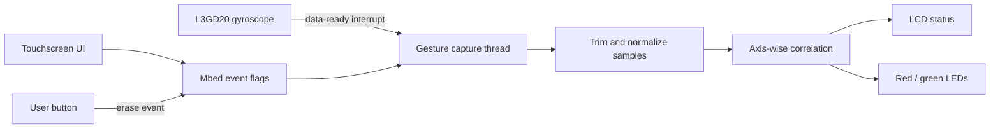

# Embedded Sentry

A gesture-based access-control prototype for the STM32F429I Discovery board. A user records a motion key with the onboard gyroscope, then repeats the gesture to unlock the device through a touchscreen workflow.

Built as the final project for NYU Tandon's Real-Time Embedded Systems course by Nikhil Arora, Devanshi Bhavsar, and Nishant Sharma.

## System behavior

1. The touchscreen presents **Record** and **Unlock** actions.
2. The gyroscope thread samples a five-second gesture at approximately 20 Hz.
3. Leading and trailing low-motion samples are removed before comparison.
4. A later gesture is compared with the recorded key using per-axis correlation.
5. Matching at least two axes above the configured threshold produces a successful unlock.
6. The LCD and red/green LEDs report the current state and result.



## Engineering details

- **Target:** STM32F429I Discovery (`disco_f429zi`)
- **Framework:** Mbed OS through PlatformIO
- **Concurrency:** separate gyroscope and touchscreen threads coordinated with event flags
- **Input:** L3GD20 three-axis gyroscope and resistive touchscreen
- **Processing:** calibrated degrees-per-second samples, motion trimming, moving-average helpers, and correlation-based matching
- **Feedback:** ILI9341 LCD plus board LEDs

The repository also contains board-support and display-driver sources required by the target hardware.

## Build and upload

Install [PlatformIO](https://platformio.org/), connect an STM32F429I Discovery board, and run:

```bash
pio run
pio run --target upload
pio device monitor
```

The target configuration and dependency are declared in `platformio.ini`.

## Use

1. Tap **Record** and follow the LCD countdown.
2. Perform the gesture while `Recording...` is displayed.
3. Tap **Unlock** and repeat the gesture.
4. Read the result on the LCD; the LEDs provide the same success/failure signal.
5. Press the blue user button to clear the in-memory key.

## Repository layout

```text
src/main.cpp       Application state, threads, UI, capture, and matching
src/gyro.cpp       Gyroscope configuration and calibrated reads
src/drivers/       LCD, touchscreen, and board-support drivers
platformio.ini     PlatformIO target and Mbed dependency
mbed_app.json      Mbed configuration
```

## Demo

The [hardware demonstration video](https://drive.google.com/file/d/1XnuLoiNUIDBEB5JB6jkdJXZcMMoeNVD6/view?usp=sharing) shows the record and unlock workflow on the board.

## Scope

This is a course prototype, not a security product. The threshold was tuned for a controlled demonstration, the recorded key remains in memory during the active session, and the implementation does not provide cryptographic identity, tamper resistance, or a production-grade false-acceptance evaluation.
